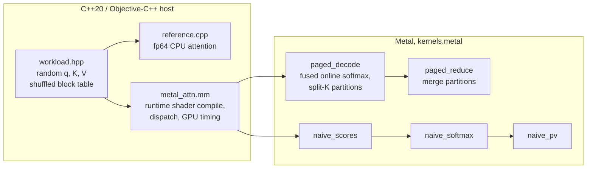

# kv-cache-bench

A decode-step attention kernel for a **paged KV cache**, written in Metal for Apple silicon, with
a C++20 CPU reference, tolerance-based correctness tests for fp32 and fp16 cache storage, and a
benchmark against a naive GPU implementation and the CPU reference, measured on an Apple M4 Max.

Decode is the token-by-token phase of LLM inference: every new token's query attends to the
whole KV history of its sequence, so the step reads the entire cache once and does little math
per byte. It is bound by memory bandwidth, and the job of the kernel is to stream K and V at as
close to the memory system's speed as possible while the cache sits in fixed-size blocks
scattered through a pool (as in vLLM's PagedAttention), not in one contiguous array.

A personal project, written from scratch. Ideas it uses come from published work and are cited
where they are used: paged KV cache (Kwon et al., *Efficient Memory Management for Large
Language Model Serving with PagedAttention*, SOSP 2023), online softmax (Milakov & Gimelshein,
*Online normalizer calculation for softmax*, 2018), split-K over the sequence (Dao et al.,
*Flash-Decoding for long-context inference*, 2023). No code was taken from vLLM, llama.cpp, MLX
or other implementations.

## What is shown, and by what

| Claim | Evidence |
|---|---|
| The paged kernel matches an fp64 reference for fp32 and fp16 storage | `make test`: 7 CPU tests, 540 GPU checks, 0 failed ([`results/make-test.txt`](results/make-test.txt)) |
| The tests can tell a broken kernel from a correct one | `make mutation`: 6 injected bugs, each caught ([`scripts/mutation.sh`](scripts/mutation.sh), [`results/mutation.txt`](results/mutation.txt)) |
| fp16 storage stays within an error bound derived from fp16 rounding | `gpu_tests`, check `paged-f16-vs-f32-data`, worst error is 0.087 of the bound |
| Speed and effective bandwidth vs naive GPU and CPU, 512–32k tokens, pages 16–128 | [Numbers](#numbers) (pending) |
| Sharing one K/V read across a GQA group matters | [GQA ablation](#ablations) (pending) |
| The split-K partition size must follow the context length | [Partition sweep](#ablations) (pending) |

CI ([`.github/workflows/ci.yml`](.github/workflows/ci.yml)) builds on a GitHub `macos-15` Apple
silicon runner and runs both test binaries. The runner exposes an "Apple Paravirtual device",
and the GPU tests pass on it too. If a runner has no Metal device, `gpu_tests` prints `SKIP`
and exits 77, which CTest reports as skipped. No performance number comes from CI.

## Run

Requirements: macOS on Apple silicon, Xcode command line tools (Apple clang), CMake ≥ 3.24.
No other dependencies. The offline Metal compiler is **not** needed: shaders are compiled at
run time from source embedded in the binary.

```bash
make test             # build, CPU tests, GPU correctness grid
make bench LABEL=me   # full sweep, writes results/me/
make mutation         # inject bugs into the kernel, check the tests catch each
```

## Architecture



| File | What it is |
|---|---|
| [`src/kernels.metal`](src/kernels.metal) | all GPU kernels: paged fused decode + reduce, the 3-pass naive baseline, a read-bandwidth probe |
| [`src/metal_attn.mm`](src/metal_attn.mm) | Metal host code: shader compilation per (head_dim, group, page, dtype), pipelines, buffers, timing |
| [`src/reference.cpp`](src/reference.cpp) | fp64 CPU reference (two-pass softmax), block-table allocation |
| [`src/workload.hpp`](src/workload.hpp) | test/benchmark data: contiguous and paged copies of the same cache |
| [`tests/`](tests/) | `cpu_tests` (exact properties), `gpu_tests` (kernels vs reference over a grid) |
| [`bench/bench.cpp`](bench/bench.cpp) | the benchmark, CSV out |

**Shapes.** One decode step for `B` sequences, `H` query heads, `Hkv` KV heads (grouped-query
attention, group `G = H / Hkv`), head dim `D` ∈ {64, 128}. The benchmark uses a Llama-3-8B-like
layer: `H = 32`, `Hkv = 8`, `D = 128`, `B = 2`. `q` and the output are fp32; K and V are stored
as fp32 or fp16; all arithmetic is fp32.

**Paged layout.** The cache is a pool of physical blocks; a block holds `page_size` tokens of
all KV heads, laid out `[block][Hkv][page_size][D]`. Logical block `i` of sequence `b` is
`block_table[b][i]`. Tests and the benchmark assign physical blocks in a shuffled order, so
logically adjacent blocks are not adjacent in memory.

**`paged_decode`.** Grid `(partitions, Hkv, B)`, 128 threads (4 simdgroups) per threadgroup.
A threadgroup takes one partition of the sequence (split-K) for one KV head and computes all
`G` query heads of that KV head, so each K/V row is loaded once per group. Inside, simdgroup
`s` takes tokens `t0+s, t0+s+4, …`; lane `i` holds elements `[i·D/32, (i+1)·D/32)` of the row
(one `float4` or `half4` load for `D = 128`, so a simdgroup reads a whole contiguous row in one
request). Per token and query head: `simd_sum` of the partial dot products, then one online
softmax update of the running max `m`, sum `l` and unnormalized accumulator. The four
simdgroup states are merged in threadgroup memory and the partition writes its normalized
output and `(m, l)`. **`paged_reduce`** merges the partitions with weights `l_p·exp(m_p − M)`.
Partition size is picked automatically (`auto_part_tokens`, see the sweep below).

**Naive baseline.** What a first GPU port looks like: contiguous cache `[B][Hkv][max_len][D]`,
three kernels, scores materialized in global memory: one thread per (token, head) computes a
dot product, one threadgroup per head does max / exp-sum / normalize, one thread per output
element sums `p_t·v_t` over all tokens.

**Timing.** Each measured run is one command buffer; time is `GPUEndTime − GPUStartTime`
(GPU execution only: no shader compile, no CPU encode). Before each timed run a 256 MiB blit
fill evicts the cache data from the GPU's caches (the real decode step reads a layer's KV once
per token, so cold-cache is the honest case). Each point: 3 warm-up runs, then 30 timed runs, median reported (min and max are in the CSV); the CPU reference: 1 warm-up, 3 timed runs, wall clock. Effective bandwidth is the
minimum traffic of the step (K and V of every live token, plus q and out) divided by the
median time; the workspace traffic of split-K is not counted.

## Design decisions

- **Metal, not CUDA.** The hardware at hand is an M4 Max; there is no NVIDIA GPU. The
  constraints are the same kind (memory-bound streaming, SIMD-group reductions, threadgroup
  memory), and Apple's unified memory removes host↔device copies, so the benchmark measures
  only the kernel. Host code is Objective-C++ against the system Metal framework, no
  third-party wrapper.
- **Runtime shader compilation.** The offline Metal toolchain is a separate download; compiling
  with `newLibraryWithSource` keeps the build to Xcode CLT + CMake. Head dim, group size, page
  size and storage type are preprocessor macros, so each variant is compiled with constant
  loop bounds (`t / page` becomes a shift, per-lane arrays stay in registers). Compile time is
  outside every measurement.
- **Page layout `[block][Hkv][page][D]`.** A token's row for one head is `D` contiguous elements,
  which one simdgroup reads in one coalesced request; a page of one head is one contiguous
  chunk of `page·D` elements. Putting all heads of a block together means one block-table
  entry serves every head. Larger pages mean fewer table lookups but more internal
  fragmentation (the last block of a sequence is on average half empty).
- **Fused online softmax.** The naive version writes `B·H·len` scores to memory, reads them back
  three times, and launches three kernels. The online form keeps `(m, l, acc)` in registers,
  rescales the accumulator when the max grows, and touches K and V exactly once. The max shift
  also keeps `exp` from overflowing on large scores (a CPU test checks the reference does the same).
- **Split-K partitions + a reduce kernel.** One threadgroup per (sequence, head) would give only
  `B·Hkv = 16` threadgroups for 40 GPU cores, whatever the context length. Splitting the
  sequence into partitions creates enough independent work; the cost is a tiny second kernel and
  a workspace of `B·H·partitions·(D+2)` floats.
- **One threadgroup per KV head, not per query head.** With GQA, 4 query heads read the same K/V.
  Serving them from one threadgroup reads K/V once instead of 4 times; whether the GPU caches
  would hide the repeated reads is what the GQA ablation measures.
- **fp32 accumulation for fp16 storage.** fp16 halves the bytes, which is what a bandwidth-bound
  kernel cares about; converting `half4 → float4` in registers is free next to the memory
  latency. Accumulating in fp16 loses about 3 decimal digits: the fp16-accumulator mutation test
  gives a maximum error of 1.1e-3, against 1.4e-6 for the real kernel.
- **fp64 two-pass CPU reference.** The reference must be much more accurate than what it
  checks, and it should share as little as possible with the kernel: different algorithm
  (two-pass, not online), different precision, contiguous layout instead of paged.

## Tolerances

All tests use `|q| ≤ q_amp` (1, 3 or 8), `|K|, |V| ≤ 1`, `D ∈ {64, 128}`, scale `1/√D`. The output
is a convex combination of V rows, so `|out| ≤ max|v| = 1` and an absolute tolerance is the
right measure.

1. **Kernel vs reference on the same stored values: `2e-5` absolute, for both storage types.**
   fp16 → fp32 conversion is exact, so with fp16 storage the kernel and the reference see the same
   numbers and the only error is the kernel's fp32 arithmetic. A first-order estimate: an fp32 dot
   product of length 128 has relative error up to about `log2(128)·2⁻²⁴ ≈ 4e-7` with tree-like
   summation, times `scale·Σ|q_d k_d|` (up to ≈ 23 for `q_amp = 8`) gives a score error ~`1e-5`;
   a score error `δ` changes the softmax weights by a factor `e^{±δ}` and the output by `≲ 2δ`.
   Fast-math `exp` and the `p·v` sums add errors of the same order. The observed maximum over
   all 540 checks is 1.42e-6 (fp32 storage) and 1.19e-6 (fp16 storage), so the tolerance has margin over the actual rounding noise and is
   still ~50× below the smallest real bug the mutation tests produce (an fp16 accumulator:
   1.1e-3, [`results/mutation.txt`](results/mutation.txt)).
2. **fp16 storage vs the unrounded fp32 data: a bound derived per test case.** Rounding to fp16
   (unit roundoff `u = 2⁻¹¹`) moves each score by at most `E = u·scale·max_t Σ_d |q_d k_td|`,
   which changes each softmax weight by a factor within `e^{±2E}` after normalization, and moves
   each V element by at most `u·|v|`. So `|out_f16 − out_exact| ≤ max|v|·(u + e^{2E} − 1)` plus
   the tolerance of (1). This is what fp16 storage costs in accuracy; the test checks the kernel
   does not lose more than that.

## Numbers

_Not measured yet: the final sweep runs only on a quiet machine (no other workloads), and has not been run. Preliminary runs under heavy load are kept in [`results/prelim-under-load/`](results/prelim-under-load/) and are not reported here._

## Ablations

Two sweeps are part of `make bench`: split-K partition size (64…2048 tokens, page 32) in `parts.csv`, and one threadgroup per KV head vs per query head (`--per-head`) in `gqa.csv`.

_Not measured yet: the final sweep runs only on a quiet machine (no other workloads), and has not been run. Preliminary runs under heavy load are kept in [`results/prelim-under-load/`](results/prelim-under-load/) and are not reported here._

## What I learned

_Written from the final measurements once they exist._

## Reproduce

```bash
make bench LABEL=mine   # writes results/mine/{env.txt,bw.csv,bench.csv,parts.csv,gqa.csv}
./build/kvbench --lens=4096 --pages=16 --types=f16 --reps=50   # one point; flags are listed in bench/bench.cpp
python3 scripts/tables.py mine   # the markdown tables used below, from results/mine/
```

`env.txt` records the machine (chip, cores, memory, GPU cores from `system_profiler
SPDisplaysDataType`, macOS) and the load average and number of running Docker containers before
and after. The largest case (32k tokens, fp32, B = 2) holds a contiguous and a paged copy of a
512 MiB cache (K + V) plus a 256 MiB flush buffer.

## Limitations

- One machine. Absolute numbers are for an M4 Max with a 40-core GPU; other Apple GPUs have
  different bandwidth and core counts.
- Decode only (one query token per sequence); no prefill, no causal mask, no ALiBi/RoPE, no
  sliding window. `D` is 64 or 128 only.
- The cache flush before timed runs is best effort: Apple does not document the GPU cache
  hierarchy, so a 256 MiB fill is assumed to be larger than the last-level cache.
- Effective bandwidth counts only the minimum traffic. Block-table reads and split-K workspace
  traffic are real but are not counted, so the figure slightly understates the bytes moved.
- The CPU reference is fp64 scalar code on 16 threads, written for accuracy, not speed; it is a
  baseline for "how far off a straightforward CPU loop is", not an optimized CPU kernel.

## License

MIT, see [LICENSE](LICENSE). No third-party code or libraries; only Apple's system frameworks
(Metal, Foundation) and the C++ standard library.
