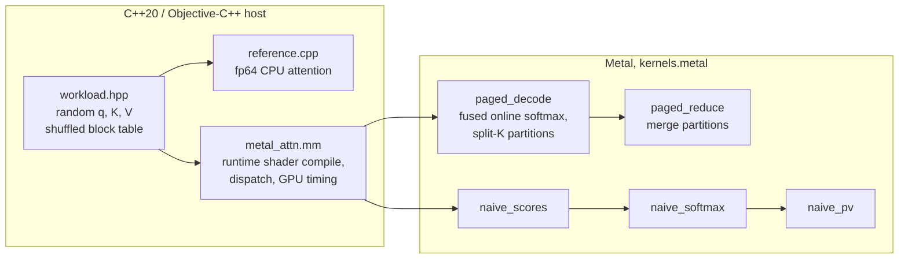

# kv-cache-bench

A decode-step attention kernel for a **paged KV cache**, written in Metal for Apple silicon, with
a C++20 CPU reference, tolerance-based correctness tests for fp32 and fp16 cache storage, and a
benchmark against a naive GPU implementation and the CPU reference, measured on an Apple M4 Max.

Decode is the token-by-token phase of LLM inference: every new token's query attends to the
whole KV history of its sequence, so the step reads the entire cache once and does little math
per byte. It is bound by memory bandwidth, and the job of the kernel is to stream K and V at as
close to the memory system's speed as possible while the cache sits in fixed-size blocks
scattered through a pool (as in vLLM's PagedAttention), not in one contiguous array.

A personal project, written from scratch. Ideas it uses come from published work and are cited
where they are used: paged KV cache (Kwon et al., *Efficient Memory Management for Large
Language Model Serving with PagedAttention*, SOSP 2023), online softmax (Milakov & Gimelshein,
*Online normalizer calculation for softmax*, 2018), split-K over the sequence (Dao et al.,
*Flash-Decoding for long-context inference*, 2023). No code was taken from vLLM, llama.cpp, MLX
or other implementations.

## What is shown, and by what

| Claim | Evidence |
|---|---|
| The paged kernel matches an fp64 reference for fp32 and fp16 storage | `make test`: 7 CPU tests, 540 GPU checks, 0 failed ([`results/make-test.txt`](results/make-test.txt)) |
| The tests can tell a broken kernel from a correct one | `make mutation`: 6 injected bugs, each caught ([`scripts/mutation.sh`](scripts/mutation.sh), [`results/mutation.txt`](results/mutation.txt)) |
| fp16 storage stays within an error bound derived from fp16 rounding | `gpu_tests`, check `paged-f16-vs-f32-data`, worst error is 0.087 of the bound |
| Speed and effective bandwidth vs naive GPU and CPU, 512–32k tokens, pages 16–128 | [Numbers](#numbers), 3 full runs, raw CSV in [`results/`](results/) |
| Sharing one K/V read across a GQA group matters at long context only | [GQA ablation](#ablations): 1.49× at 32k, none at ≤ 2k |
| The split-K partition size must follow the context length | [Partition sweep](#ablations): 1.9× at 512 tokens |

CI ([`.github/workflows/ci.yml`](.github/workflows/ci.yml)) builds on a GitHub `macos-15` Apple
silicon runner and runs both test binaries. The runner exposes an "Apple Paravirtual device",
and the GPU tests pass on it too
([`results/ci-log-excerpt.txt`](results/ci-log-excerpt.txt)). If a runner has no Metal device, `gpu_tests` prints `SKIP`
and exits 77, which CTest reports as skipped. No performance number comes from CI.

## Run

Requirements: macOS on Apple silicon, Xcode command line tools (Apple clang), CMake ≥ 3.24.
No other dependencies. The offline Metal compiler is **not** needed: shaders are compiled at
run time from source embedded in the binary.

```bash
make test             # build, CPU tests, GPU correctness grid
make bench LABEL=me   # full sweep, writes results/me/
make mutation         # inject bugs into the kernel, check the tests catch each
```

## Architecture



| File | What it is |
|---|---|
| [`src/kernels.metal`](src/kernels.metal) | all GPU kernels: paged fused decode + reduce, the 3-pass naive baseline, a read-bandwidth probe |
| [`src/metal_attn.mm`](src/metal_attn.mm) | Metal host code: shader compilation per (head_dim, group, page, dtype), pipelines, buffers, timing |
| [`src/reference.cpp`](src/reference.cpp) | fp64 CPU reference (two-pass softmax), block-table allocation |
| [`src/workload.hpp`](src/workload.hpp) | test/benchmark data: contiguous and paged copies of the same cache |
| [`tests/`](tests/) | `cpu_tests` (exact properties), `gpu_tests` (kernels vs reference over a grid) |
| [`bench/bench.cpp`](bench/bench.cpp) | the benchmark, CSV out |

**Shapes.** One decode step for `B` sequences, `H` query heads, `Hkv` KV heads (grouped-query
attention, group `G = H / Hkv`), head dim `D` ∈ {64, 128}. The benchmark uses a Llama-3-8B-like
layer: `H = 32`, `Hkv = 8`, `D = 128`, `B = 2`. `q` and the output are fp32; K and V are stored
as fp32 or fp16; all arithmetic is fp32.

**Paged layout.** The cache is a pool of physical blocks; a block holds `page_size` tokens of
all KV heads, laid out `[block][Hkv][page_size][D]`. Logical block `i` of sequence `b` is
`block_table[b][i]`. Tests and the benchmark assign physical blocks in a shuffled order, so
logically adjacent blocks are not adjacent in memory.

**`paged_decode`.** Grid `(partitions, Hkv, B)`, 128 threads (4 simdgroups) per threadgroup.
A threadgroup takes one partition of the sequence (split-K) for one KV head and computes all
`G` query heads of that KV head, so each K/V row is loaded once per group. Inside, simdgroup
`s` takes tokens `t0+s, t0+s+4, …`; lane `i` holds elements `[i·D/32, (i+1)·D/32)` of the row
(one `float4` or `half4` load for `D = 128`, so a simdgroup reads a whole contiguous row in one
request). Per token and query head: `simd_sum` of the partial dot products, then one online
softmax update of the running max `m`, sum `l` and unnormalized accumulator. The four
simdgroup states are merged in threadgroup memory and the partition writes its normalized
output and `(m, l)`. **`paged_reduce`** merges the partitions with weights `l_p·exp(m_p − M)`.
Partition size is picked automatically (`auto_part_tokens`, see the sweep below).

**Naive baseline.** What a first GPU port looks like: contiguous cache `[B][Hkv][max_len][D]`,
three kernels, scores materialized in global memory: one thread per (token, head) computes a
dot product, one threadgroup per head does max / exp-sum / normalize, one thread per output
element sums `p_t·v_t` over all tokens.

**Timing.** Each measured run is one command buffer; time is `GPUEndTime − GPUStartTime`
(GPU execution only: no shader compile, no CPU encode). Before each timed run a 256 MiB blit
fill evicts the cache data from the GPU's caches (the real decode step reads a layer's KV once
per token, so cold-cache is the honest case). All flush and kernel command buffers of one
point are submitted back to back without CPU waits, chained by an `MTLEvent` so they never
overlap (`begin_pipelined` in [`src/metal_attn.hpp`](src/metal_attn.hpp)); why this matters is
the first item of [What I learned](#what-i-learned). Each point: 3 warm-up runs, then 30 timed
runs, median reported (min and max are in the CSV). CPU reference: 1 warm-up, 3 timed runs,
wall clock, 16 threads. Effective bandwidth is the
minimum traffic of the step (K and V of every live token, plus q and out) divided by the
median time; the workspace traffic of split-K is not counted.

## Design decisions

- **Metal, not CUDA.** The hardware at hand is an M4 Max; there is no NVIDIA GPU. The
  constraints are the same kind (memory-bound streaming, SIMD-group reductions, threadgroup
  memory), and Apple's unified memory removes host↔device copies, so the benchmark measures
  only the kernel. Host code is Objective-C++ against the system Metal framework, no
  third-party wrapper.
- **Runtime shader compilation.** The offline Metal toolchain is a separate download; compiling
  with `newLibraryWithSource` keeps the build to Xcode CLT + CMake. Head dim, group size, page
  size and storage type are preprocessor macros, so each variant is compiled with constant
  loop bounds (`t / page` becomes a shift, per-lane arrays stay in registers). Compile time is
  outside every measurement.
- **Page layout `[block][Hkv][page][D]`.** A token's row for one head is `D` contiguous elements,
  which one simdgroup reads in one coalesced request; a page of one head is one contiguous
  chunk of `page·D` elements. Putting all heads of a block together means one block-table
  entry serves every head. Larger pages mean fewer table lookups but more internal
  fragmentation (the last block of a sequence is on average half empty).
- **Fused online softmax.** The naive version writes `B·H·len` scores to memory, reads them back
  three times, and launches three kernels. The online form keeps `(m, l, acc)` in registers,
  rescales the accumulator when the max grows, and touches K and V exactly once. The max shift
  also keeps `exp` from overflowing on large scores (a CPU test checks the reference does the same).
- **Split-K partitions + a reduce kernel.** One threadgroup per (sequence, head) would give only
  `B·Hkv = 16` threadgroups for 40 GPU cores, whatever the context length. Splitting the
  sequence into partitions creates enough independent work; the cost is a tiny second kernel and
  a workspace of `B·H·partitions·(D+2)` floats.
- **One threadgroup per KV head, not per query head.** With GQA, 4 query heads read the same K/V.
  Serving them from one threadgroup reads K/V once instead of 4 times; whether the GPU caches
  would hide the repeated reads is what the GQA ablation measures.
- **fp32 accumulation for fp16 storage.** fp16 halves the bytes, which is what a bandwidth-bound
  kernel cares about; converting `half4 → float4` in registers is free next to the memory
  latency. Accumulating in fp16 loses about 3 decimal digits: the fp16-accumulator mutation test
  gives a maximum error of 1.11e-3 (fp32 storage) and 1.22e-3 (fp16 storage), against 1.42e-6
  for the real kernel.
- **fp64 two-pass CPU reference.** The reference must be much more accurate than what it
  checks, and it should share as little as possible with the kernel: different algorithm
  (two-pass, not online), different precision, contiguous layout instead of paged.

## Tolerances

All tests use `|q| ≤ q_amp` (1, 3 or 8), `|K|, |V| ≤ 1`, `D ∈ {64, 128}`, scale `1/√D`. The output
is a convex combination of V rows, so `|out| ≤ max|v| = 1` and an absolute tolerance is the
right measure.

1. **Kernel vs reference on the same stored values: `2e-5` absolute, for both storage types.**
   fp16 → fp32 conversion is exact, so with fp16 storage the kernel and the reference see the same
   numbers and the only error is the kernel's fp32 arithmetic. A first-order estimate: an fp32 dot
   product of length 128 has relative error up to about `log2(128)·2⁻²⁴ ≈ 4e-7` with tree-like
   summation, times `scale·Σ|q_d k_d|` (typically ≈ 23 for `q_amp = 8`; the worst case is `128·8/√128 ≈ 90.5`) gives a score error ~`1e-5`;
   a score error `δ` changes the softmax weights by a factor `e^{±δ}` and the output by `≲ 2δ`.
   Fast-math `exp` and the `p·v` sums add errors of the same order. The observed maximum over
   all 540 checks is 1.42e-6 (fp32 storage) and 1.19e-6 (fp16 storage), so the tolerance has margin over the actual rounding noise and is
   still 55× below the smallest real bug the mutation tests produce (an fp16 accumulator:
   up to 1.22e-3, [`results/mutation.txt`](results/mutation.txt)).
2. **fp16 storage vs the unrounded fp32 data: a bound derived per test case.** Rounding to fp16
   (unit roundoff `u = 2⁻¹¹`) moves each score by at most `E = u·scale·max_t Σ_d |q_d k_td|`,
   which changes each softmax weight by a factor within `e^{±2E}` after normalization, and moves
   each V element by at most `u·|v|`. So `|out_f16 − out_exact| ≤ max|v|·(u + e^{2E} − 1)` plus
   the tolerance of (1). This is what fp16 storage costs in accuracy; the test checks the kernel
   does not lose more than that.

## Numbers

**Hardware.** Apple M4 Max (MacBook Pro), 16 CPU cores (12 performance + 4 efficiency), 40-core
GPU (`system_profiler SPDisplaysDataType`, Metal 4), 48 GiB unified memory, macOS 26.6.2 (25G83),
Apple clang 21.0.0, on AC power in High Power mode (`pmset -g`: `powermode 2`), no thermal or
performance warnings recorded ([`results/hardware.txt`](results/hardware.txt): `system_profiler
SPHardwareDataType`, `pmset`; `bench.sh` now records the same in every `env.txt`).

**Machine load.** No Docker containers were running, but the machine was not idle: the three
sweeps below ran at a load average of 24–26, from other sessions' `node` jobs and a headless
Chrome (single processes up to 560% CPU in `top`; each run's `env.txt` records `uptime` and the
top processes before and after). GPU medians repeat within a few percent ([spread](#run-to-run-spread) below); the
16-thread CPU reference competes with those processes for cores and its times are the least
reliable numbers here.

**Workload.** B = 2 sequences of equal length, H = 32 query heads, Hkv = 8 KV heads, D = 128
(a Llama-3-8B-like layer), q ~ U(−3, 3), K, V ~ U(−1, 1). Command: `make bench LABEL=m4max-run1`
at commit `60449f7`; tables rendered with `python3 scripts/tables.py m4max-run1`. Raw output:
[`results/m4max-run1/`](results/m4max-run1/), repeats in [`m4max-run2`](results/m4max-run2/) and
[`m4max-run3`](results/m4max-run3/). Every paged and CPU result agrees with the naive GPU output
to 2.24e-7 or better (last CSV column).

**Read-bandwidth probe** (`kvbench --bw`, a plain streaming read of 512 MiB): 438.0 GB/s in
run 1 (435.8 and 429.8 in runs 2 and 3).

**Paged kernel, f32 cache: median µs (effective GB/s)**

| tokens | split-K part | page 16 | page 32 | page 64 | page 128 |
|---:|---:|---:|---:|---:|---:|
| 512 | 64 | 57.2 (148) | 55.0 (154) | 56.5 (150) | 55.6 (152) |
| 1k | 64 | 94.3 (178) | 95.5 (176) | 96.3 (175) | 96.3 (175) |
| 2k | 64 | 151.7 (222) | 152.1 (221) | 152.7 (220) | 151.7 (222) |
| 4k | 128 | 225.8 (298) | 224.5 (299) | 224.5 (299) | 224.6 (299) |
| 8k | 256 | 380.5 (353) | 384.1 (350) | 382.9 (351) | 381.2 (352) |
| 16k | 512 | 685.8 (392) | 693.0 (388) | 702.0 (382) | 688.3 (390) |
| 32k | 512 | 1294.9 (415) | 1246.9 (431) | 1276.6 (421) | 1267.7 (424) |

**Paged kernel, f16 cache: median µs (effective GB/s)**

| tokens | split-K part | page 16 | page 32 | page 64 | page 128 |
|---:|---:|---:|---:|---:|---:|
| 512 | 64 | 41.4 (103) | 41.6 (102) | 40.8 (104) | 40.9 (104) |
| 1k | 64 | 65.2 (130) | 64.9 (130) | 65.0 (130) | 64.6 (131) |
| 2k | 64 | 100.5 (168) | 100.5 (168) | 101.3 (166) | 100.2 (168) |
| 4k | 128 | 160.0 (210) | 158.8 (212) | 160.6 (209) | 164.3 (205) |
| 8k | 256 | 248.9 (270) | 244.5 (275) | 247.7 (271) | 246.3 (273) |
| 16k | 512 | 407.2 (330) | 412.2 (326) | 415.7 (323) | 411.5 (326) |
| 32k | 512 | 698.2 (384) | 703.4 (382) | 705.5 (381) | 704.0 (381) |

**Against the baselines, f32 cache (paged = page 16)**

| tokens | CPU fp64, ms | naive GPU, µs | paged GPU, µs | GB/s naive / paged | paged vs naive | paged vs CPU |
|---:|---:|---:|---:|---:|---:|---:|
| 512 | 0.50 | 199.2 | 57.2 | 42 / 148 | 3.5× | 9× |
| 1k | 0.78 | 367.6 | 94.3 | 46 / 178 | 3.9× | 8× |
| 2k | 1.82 | 709.1 | 151.7 | 47 / 222 | 4.7× | 12× |
| 4k | 3.20 | 1355.0 | 225.8 | 50 / 298 | 6.0× | 14× |
| 8k | 8.59 | 2670.5 | 380.5 | 50 / 353 | 7.0× | 23× |
| 16k | 15.81 | 5184.2 | 685.8 | 52 / 392 | 7.6× | 23× |
| 32k | 22.35 | 10185.5 | 1294.9 | 53 / 415 | 7.9× | 17× |

**Against the baselines, f16 cache (paged = page 16)**

| tokens | CPU fp64, ms | naive GPU, µs | paged GPU, µs | GB/s naive / paged | paged vs naive | paged vs CPU |
|---:|---:|---:|---:|---:|---:|---:|
| 512 | 0.44 | 181.5 | 41.4 | 24 / 103 | 4.4× | 11× |
| 1k | 0.92 | 338.6 | 65.2 | 25 / 130 | 5.2× | 14× |
| 2k | 1.98 | 656.8 | 100.5 | 26 / 168 | 6.5× | 20× |
| 4k | 4.76 | 1282.1 | 160.0 | 26 / 210 | 8.0× | 30× |
| 8k | 11.78 | 2501.4 | 248.9 | 27 / 270 | 10.0× | 47× |
| 16k | 15.74 | 4829.4 | 407.2 | 28 / 330 | 11.9× | 39× |
| 32k | 34.32 | 9889.1 | 698.2 | 27 / 384 | 14.2× | 49× |

"GB/s" is the minimum traffic of the step divided by the median time. "paged vs CPU" uses the
fp64 16-thread reference, written for accuracy, not speed, and measured while other processes
took several cores.

### Run-to-run spread

**Run-to-run spread, m4max-run1 vs m4max-run2: |a − b| / mean of the two medians**

| file | impl | points | median spread | max spread | worst point |
|---|---|---:|---:|---:|---|
| bench.csv | gpu_naive | 14 | 2.1% | 5.3% | f32 16k page 0 part 0: 5184.2 vs 5468.2 µs |
| bench.csv | cpu_ref_fp64 | 14 | 24.6% | 47.7% | f16 16k page 0 part 0: 15738.9 vs 25592.5 µs |
| bench.csv | gpu_paged | 56 | 1.3% | 4.8% | f16 16k page 16 part 512: 407.2 vs 427.2 µs |
| parts.csv | gpu_paged | 48 | 3.7% | 13.1% | f16 32k page 32 part 64: 946.3 vs 830.3 µs |
| gqa.csv | gpu_paged | 8 | 3.6% | 6.8% | f32 512 page 32 part 64: 58.5 vs 54.6 µs |
| gqa.csv | gpu_paged_per_head | 8 | 1.9% | 4.2% | f16 512 page 32 part 64: 41.7 vs 40.0 µs |
| bw.csv | read_bw | 1 | 0.5% | | |

| bench.csv | gpu_naive | 14 | 2.1% | 4.0% | f32 16k page 0 part 0: 5184.2 vs 5396.4 µs |
| bench.csv | cpu_ref_fp64 | 14 | 21.0% | 50.9% | f32 4k page 0 part 0: 3203.2 vs 5388.8 µs |
| bench.csv | gpu_paged | 56 | 1.2% | 4.0% | f32 4k page 32 part 128: 224.5 vs 233.8 µs |
| parts.csv | gpu_paged | 48 | 0.9% | 10.6% | f16 32k page 32 part 64: 946.3 vs 851.4 µs |
| gqa.csv | gpu_paged | 8 | 1.8% | 3.2% | f32 32k page 32 part 512: 1256.3 vs 1296.6 µs |
| gqa.csv | gpu_paged_per_head | 8 | 1.7% | 4.5% | f16 512 page 32 part 64: 41.7 vs 39.9 µs |
| bw.csv | read_bw | 1 | 1.9% | | |

The second table is run 1 vs run 3 (same columns). GPU medians move 1–4% between full sweeps,
the worst single point 13%; the CPU reference moves 21–25% (median) because it competes with
other processes for cores.

## Ablations

Both sweeps are part of `make bench` (`parts.csv`, `gqa.csv`), run 1 shown, page 32.

**Split-K partition sweep, page 32: effective GB/s**

| dtype | tokens | part 64 | part 128 | part 256 | part 512 | part 1024 | part 2048 |
|---|---:|---:|---:|---:|---:|---:|---:|
| f32 | 512 | **149** | 147 | 123 | 80 | 80 | 80 |
| f32 | 2k | 220 | 209 | **234** | 228 | 160 | 92 |
| f32 | 8k | 335 | 350 | 343 | 316 | **364** | 314 |
| f32 | 32k | 373 | 404 | 411 | **415** | 404 | 362 |
| f16 | 512 | **102** | 95 | 68 | 44 | 44 | 44 |
| f16 | 2k | 161 | 157 | **184** | 144 | 88 | 49 |
| f16 | 8k | 262 | **278** | 265 | 232 | 273 | 176 |
| f16 | 32k | 284 | 351 | **386** | 376 | 343 | 294 |

Bold is the best partition for that row. The default (`auto_part_tokens`: 64 for ≤ 2k tokens, 256 at
8k, 512 at 32k for this shape) is the best or within 6.3% of the best in every row except fp16 at 2k
(161.2 vs 184.5 GB/s, 13% short): the "at least 512 threadgroups" rule is a heuristic, not tuned per
length.

**GQA ablation, page 32: one threadgroup per KV head (4 query heads) vs per query head**

| dtype | tokens | per KV head, µs | per query head, µs | slowdown | GB/s per KV head / per query head |
|---|---:|---:|---:|---:|---:|
| f32 | 512 | 58.5 | 58.1 | 0.99× | 144 / 145 |
| f32 | 2k | 155.4 | 153.2 | 0.99× | 216 / 220 |
| f32 | 8k | 391.6 | 423.4 | 1.08× | 343 / 317 |
| f32 | 32k | 1256.3 | 1876.7 | 1.49× | 427 / 286 |
| f16 | 512 | 42.9 | 41.7 | 0.97× | 99 / 102 |
| f16 | 2k | 103.0 | 101.6 | 0.99× | 164 / 166 |
| f16 | 8k | 245.2 | 264.8 | 1.08× | 274 / 254 |
| f16 | 32k | 696.7 | 794.7 | 1.14× | 385 / 338 |

## What I learned

1. **Measuring the GPU one run at a time measured the power state, not the kernel.** With the first
   method (commit, wait, read `GPUEndTime − GPUStartTime`, repeat), the same binary at the same point
   gave two stable answers about 2× apart: 408 µs or 216 µs for fp16 at 8k tokens, depending on the
   round ([`results/timing-method/sync-vs-pipelined.txt`](results/timing-method/sync-vs-pipelined.txt),
   load 15). Submitting the flush and kernel command buffers back to back, event-chained so they
   cannot overlap, gave 234–239 µs in every round. The GPU-side time of one command buffer depends on how busy the SoC was before it,
   so a benchmark must keep the GPU fed the way the real decode loop does.
2. **At long context the paged kernel streams K/V about as fast as a plain read kernel can read
   memory.** At 32k tokens, fp32: 415–431 GB/s across page sizes, against 429.8–438.0 GB/s for the
   streaming-read probe in the three runs. The block-table indirection costs nothing measurable: at
   every point the slowest and fastest page size differ by at most 4.9%, within the run-to-run spread.
   Even a 16-token page is 16 contiguous rows of 512 bytes (fp32), and the table entries are cached.
3. **fp16 storage halves bytes but only helps a kernel that is bound by bytes.** Paged: 1294.9 →
   698.2 µs at 32k (1.85×). Naive: 10185.5 → 9889.1 µs (3% less), and the naive kernel reaches
   only 42–53 GB/s (fp32) or 24–28 GB/s (fp16). It is limited by its strided per-thread loads and three
   passes, not by bandwidth, so cheaper data does not make it faster. That is why the gap between paged
   and naive grows from 3.5–4.4× at 512 tokens to 7.9× (fp32) and 14.2× (fp16) at 32k.
4. **Short contexts are limited by parallelism and fixed costs, not by bandwidth.** At 512 tokens
   the paged kernel reaches 148 GB/s (fp32), and fp16 saves only 28% of the time (57.2 → 41.4 µs)
   for 50% fewer bytes. With partitions of 512 tokens, a 512-token sequence is a single
   threadgroup per KV head (16 in all for 40 GPU cores) and runs at 80 GB/s; partitions of 64
   tokens give 149 GB/s. Long contexts want the opposite: at 32k, partitions of 64 tokens
   lose 10% to the extra merge work against 512. Hence a partition size that depends on the length.
5. **Sharing K/V across a GQA group only pays off when the cache is long.** One threadgroup per KV head
   (4 query heads) vs one per query head: 1.49× faster at 32k (fp32), 1.14× (fp16), 1.08× at 8k, and
   no gain (0.97–0.99×) at 512 and 2k. My reading, not verified with counters: with a short sequence
   the four threadgroups of a group read the same rows at about the same time and hit in cache, while at
   32k the extra 4× traffic reaches DRAM.
6. **Arithmetic tweaks showed no gain in a memory-bound kernel.** Two tokens per loop iteration
   ([`results/unroll-ab/ab.txt`](results/unroll-ab/ab.txt), 5 interleaved rounds at load 12–14): the
   medians of the two variants differ by at most 2.1% at every point, while single rounds of one
   point span up to 21%, so no gain was detected. One `exp` per token instead of two
   ([`results/prelim-under-load/one-exp-ab.txt`](results/prelim-under-load/one-exp-ab.txt)) was only
   measured under load 35–41, where paired runs differ by up to 19%: no gain detected there either,
   which is weaker evidence. In both cases the simpler code stayed.
7. **In Objective-C++ called from a C++ `main`, a getter can leak.** `[MTLBuffer contents]` retains
   and autoreleases the buffer; with no autorelease pool every buffer the CPU had touched stayed alive,
   and the sweep's peak footprint was 8.49 GB. Taking the pointer once inside `@autoreleasepool` brought it
   to 2.10 GB (1.65 GB RSS), re-measured on commit `f22e3fc` ([`results/peak-rss.txt`](results/peak-rss.txt)).
8. **The tolerance has to be argued from both sides.** The kernel's real error is 1.42e-6. The
   tolerance (2e-5) is 14× above that and 55× below the error of an fp16 accumulator (1.11e-3 to 1.22e-3), the
   subtlest of the six injected bugs. A tolerance taken from fp16 storage error (~1e-3) would have
   passed that bug.

## Reproduce

```bash
make bench LABEL=mine   # writes results/mine/{env.txt,bw.csv,bench.csv,parts.csv,gqa.csv}
./build/kvbench --lens=4096 --pages=16 --types=f16 --reps=50   # one point; flags are listed in bench/bench.cpp
python3 scripts/tables.py mine   # the markdown tables of the Numbers section, from results/mine/
python3 scripts/tables.py mine other   # run-to-run spread between two labels
```

`env.txt` records the machine (chip, cores, memory, GPU cores from `system_profiler
SPDisplaysDataType`, macOS) and the load average and number of running Docker containers before
and after, and the top processes by CPU. The largest case (32k tokens, fp32, B = 2) holds a
contiguous and a paged copy of a 512 MiB cache (K + V) plus a 256 MiB flush buffer; the peak
footprint of the whole default sweep is 2.10 GB, 1.65 GB resident, at commit `f22e3fc`
([`results/peak-rss.txt`](results/peak-rss.txt), `/usr/bin/time -l`).

## Limitations

- The machine was not idle during the final runs (load average 24–26 from other processes, see
  [Numbers](#numbers)). GPU results repeat within a few percent; CPU-reference times do not.
- The read-bandwidth probe is a simple kernel, not the hardware's peak: the paged kernel reaches
  95–98% of it at 32k (fp32, run 1), so it is a measured reference point, not a ceiling.
- One machine. Absolute numbers are for an M4 Max with a 40-core GPU; other Apple GPUs have
  different bandwidth and core counts.
- Decode only (one query token per sequence); no prefill, no causal mask, no ALiBi/RoPE, no
  sliding window. `D` is 64 or 128 only.
- The cache flush before timed runs is best effort: Apple does not document the GPU cache
  hierarchy, so a 256 MiB fill is assumed to be larger than the last-level cache.
- Effective bandwidth counts only the minimum traffic. Block-table reads and split-K workspace
  traffic are real but are not counted, so the figure slightly understates the bytes moved.
- The CPU reference is fp64 scalar code on 16 threads, written for accuracy, not speed; it is a
  baseline for "how far off a straightforward CPU loop is", not an optimized CPU kernel.

## License

MIT, see [LICENSE](LICENSE). No third-party code or libraries; only Apple's system frameworks
(Metal, Foundation) and the C++ standard library.
