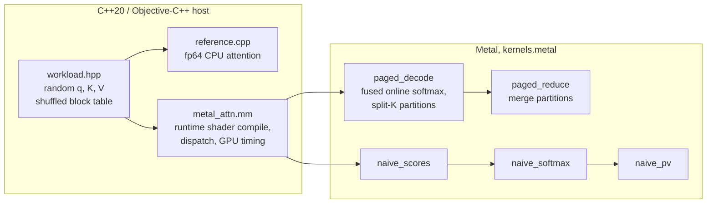

# kv-cache-bench

A decode-step attention kernel for a **paged KV cache**, written in Metal for Apple silicon, with
a C++20 CPU reference, tolerance-based correctness tests for fp32, fp16 and int8 cache storage, a
benchmark against a naive GPU implementation and the CPU reference, and a comparison with the
attention ops of llama.cpp and MLX on the same shapes, measured on an Apple M4 Max.

Decode is the token-by-token phase of LLM inference: every new token's query attends to the
whole KV history of its sequence, so the step reads the entire cache once and does little math
per byte. It is bound by memory bandwidth, and the job of the kernel is to stream K and V at as
close to the memory system's speed as possible while the cache sits in fixed-size blocks
scattered through a pool (as in vLLM's PagedAttention), not in one contiguous array.

Written by the AI coding agent Claude Code (Anthropic) under Rabiya's direction, see
[How it was built](#how-it-was-built). Ideas it uses come from published work and are cited
where they are used: paged KV cache (Kwon et al., *Efficient Memory Management for Large
Language Model Serving with PagedAttention*, SOSP 2023), online softmax (Milakov & Gimelshein,
*Online normalizer calculation for softmax*, 2018), split-K over the sequence (Dao et al.,
*Flash-Decoding for long-context inference*, 2023). No code was taken from vLLM, llama.cpp, MLX
or other implementations; llama.cpp and MLX are only run, unmodified, as baselines by
`make bench-compare`.

## What is shown, and by what

| Claim | Evidence |
|---|---|
| The paged kernel matches an fp64 reference for fp32, fp16 and int8 storage | `make test`: 9 CPU tests, 846 GPU checks, 0 failed ([`results/make-test.txt`](results/make-test.txt)) |
| The tests can tell a broken kernel from a correct one | `make mutation`: 10 injected bugs (4 of them in the int8 path), each caught ([`scripts/mutation.sh`](scripts/mutation.sh), [`results/mutation.txt`](results/mutation.txt)) |
| fp16 storage stays within an error bound derived from fp16 rounding | `gpu_tests`, check `paged-f16-vs-f32-data`, worst error is 0.087 of the bound |
| int8 storage stays within an error bound derived from its per-block scales | `gpu_tests`, check `paged-i8-vs-f32-data`, worst error is 0.117 of the bound |
| Speed and effective bandwidth vs naive GPU and CPU, 512–32k tokens, pages 16–128 | [Numbers](#numbers), one run on a quiet machine, raw CSV in [`results/m4max-final/`](results/m4max-final/) |
| int8 halves the cache and is 1.14–1.46× faster than fp16, at 17–25× its error | [int8 cache](#int8-cache) |
| Same op, same data, same timing as llama.cpp and MLX: 1.06–2.58× faster in fp32 and int8, 0.81–1.38× their speed in fp16 | [Comparison](#comparison-with-llama-cpp-and-mlx), `make bench-compare` |
| Sharing one K/V read across a GQA group matters at long context only | [GQA ablation](#ablations): 1.53× at 32k, none at ≤ 2k |
| The split-K partition size must follow the context length | [Partition sweep](#ablations): 1.9× at 512 tokens |

CI ([`.github/workflows/ci.yml`](.github/workflows/ci.yml)) builds on a GitHub `macos-15` Apple
silicon runner and runs both test binaries. The runner exposes an "Apple Paravirtual device",
and the GPU tests pass on it too
([`results/ci-log-excerpt.txt`](results/ci-log-excerpt.txt)). If a runner has no Metal device, `gpu_tests` prints `SKIP`
and exits 77, which CTest reports as skipped. No performance number comes from CI.

## Run

Requirements: macOS on Apple silicon, Xcode command line tools (Apple clang), CMake ≥ 3.24.
No other dependencies. The offline Metal compiler is **not** needed: shaders are compiled at
run time from source embedded in the binary.

```bash
make test             # build, CPU tests, GPU correctness grid
make bench LABEL=me   # full sweep, writes results/me/
make mutation         # inject bugs into the kernel, check the tests catch each
make bench-compare LABEL=me   # vs llama.cpp and MLX, writes results/me/compare.csv
```

`make bench-compare` is the only target with dependencies, and it fetches them itself into
`build-cmp/` on first use: llama.cpp release `b12000` (commit `68d20b8`) as a source tarball
pinned by SHA-256 in [`CMakeLists.txt`](CMakeLists.txt), built with its Metal backend in a
temporary directory of which only the static `vs_llamacpp` binary (6 MB) is kept, and a
Python venv with the versions in [`bench/requirements-compare.txt`](bench/requirements-compare.txt)
(`mlx==0.32.4`, `numpy==2.5.4`, about 280 MB). It needs network access and 15 GB of free disk on
first use (the script checks), and `python3` ≥ 3.10.

## Architecture



| File | What it is |
|---|---|
| [`src/kernels.metal`](src/kernels.metal) | all GPU kernels: paged fused decode + reduce, the 3-pass naive baseline, a read-bandwidth probe |
| [`src/metal_attn.mm`](src/metal_attn.mm) | Metal host code: shader compilation per (head_dim, group, page, dtype), pipelines, buffers, timing |
| [`src/reference.cpp`](src/reference.cpp) | fp64 CPU reference (two-pass softmax), block-table allocation |
| [`src/workload.hpp`](src/workload.hpp) | test/benchmark data: contiguous and paged copies of the same cache |
| [`tests/`](tests/) | `cpu_tests` (exact properties), `gpu_tests` (kernels vs reference over a grid) |
| [`bench/bench.cpp`](bench/bench.cpp) | the benchmark, CSV out; also `--accuracy` (error per storage type), `--chain` (timing used for the comparison), `--dump` (inputs for MLX) |
| [`bench/vs_llamacpp.cpp`](bench/vs_llamacpp.cpp) | llama.cpp's `ggml_flash_attn_ext` on the same shape and data |
| [`bench/vs_mlx.py`](bench/vs_mlx.py) | MLX's `mx.fast.scaled_dot_product_attention` on the same shape and data |
| [`scripts/`](scripts/) | `bench.sh`, `compare.sh` (the two sweeps), `mutation.sh`, `tables.py` (README tables from CSV) |

**Shapes.** One decode step for `B` sequences, `H` query heads, `Hkv` KV heads (grouped-query
attention, group `G = H / Hkv`), head dim `D` ∈ {64, 128}. The benchmark uses a Llama-3-8B-like
layer: `H = 32`, `Hkv = 8`, `D = 128`, `B = 2`. `q` and the output are fp32; K and V are stored
as fp32, fp16 or int8; all arithmetic is fp32.

**Paged layout.** The cache is a pool of physical blocks; a block holds `page_size` tokens of
all KV heads, laid out `[block][Hkv][page_size][D]`. Logical block `i` of sequence `b` is
`block_table[b][i]`. Tests and the benchmark assign physical blocks in a shuffled order, so
logically adjacent blocks are not adjacent in memory.

**`paged_decode`.** Grid `(partitions, Hkv, B)`, 128 threads (4 simdgroups) per threadgroup.
A threadgroup takes one partition of the sequence (split-K) for one KV head and computes all
`G` query heads of that KV head, so each K/V row is loaded once per group. Inside, simdgroup
`s` takes tokens `t0+s, t0+s+4, …`; lane `i` holds elements `[i·D/32, (i+1)·D/32)` of the row
(one `float4` or `half4` load for `D = 128`, so a simdgroup reads a whole contiguous row in one
request). Per token and query head: `simd_sum` of the partial dot products, then one online
softmax update of the running max `m`, sum `l` and unnormalized accumulator. The four
simdgroup states are merged in threadgroup memory and the partition writes its normalized
output and `(m, l)`. **`paged_reduce`** merges the partitions with weights `l_p·exp(m_p − M)`.
Partition size is picked automatically (`auto_part_tokens`, see the sweep below).

**Naive baseline.** What a first GPU port looks like: contiguous cache `[B][Hkv][max_len][D]`,
three kernels, scores materialized in global memory: one thread per (token, head) computes a
dot product, one threadgroup per head does max / exp-sum / normalize, one thread per output
element sums `p_t·v_t` over all tokens.

**Timing.** Each measured run is one command buffer; time is `GPUEndTime − GPUStartTime`
(GPU execution only: no shader compile, no CPU encode). Before each timed run a 256 MiB blit
fill evicts the cache data from the GPU's caches (the real decode step reads a layer's KV once
per token, so cold-cache is the honest case). All flush and kernel command buffers of one
point are submitted back to back without CPU waits, chained by an `MTLEvent` so they never
overlap (`begin_pipelined` in [`src/metal_attn.hpp`](src/metal_attn.hpp)); why this matters is
the first item of [Findings](#findings). Each point: 3 warm-up runs, then 30 timed
runs, median reported (min and max are in the CSV). CPU reference: 1 warm-up, 3 timed runs,
wall clock, 16 threads. Effective bandwidth is the
minimum traffic of the step (K and V of every live token, plus q and out) divided by the
median time; the workspace traffic of split-K is not counted.

## Design decisions

- **Metal, not CUDA.** The hardware at hand is an M4 Max; there is no NVIDIA GPU. The
  constraints are the same kind (memory-bound streaming, SIMD-group reductions, threadgroup
  memory), and Apple's unified memory removes host↔device copies, so the benchmark measures
  only the kernel. Host code is Objective-C++ against the system Metal framework, no
  third-party wrapper.
- **Runtime shader compilation.** The offline Metal toolchain is a separate download; compiling
  with `newLibraryWithSource` keeps the build to Xcode CLT + CMake. Head dim, group size, page
  size and storage type are preprocessor macros, so each variant is compiled with constant
  loop bounds (`t / page` becomes a shift, per-lane arrays stay in registers). Compile time is
  outside every measurement.
- **Page layout `[block][Hkv][page][D]`.** A token's row for one head is `D` contiguous elements,
  which one simdgroup reads in one coalesced request; a page of one head is one contiguous
  chunk of `page·D` elements. Putting all heads of a block together means one block-table
  entry serves every head. Larger pages mean fewer table lookups but more internal
  fragmentation (the last block of a sequence is on average half empty).
- **Fused online softmax.** The naive version writes `B·H·len` scores to memory, reads them back
  three times, and launches three kernels. The online form keeps `(m, l, acc)` in registers,
  rescales the accumulator when the max grows, and touches K and V exactly once. The max shift
  also keeps `exp` from overflowing on large scores (a CPU test checks the reference does the same).
- **Split-K partitions + a reduce kernel.** One threadgroup per (sequence, head) would give only
  `B·Hkv = 16` threadgroups for 40 GPU cores, whatever the context length. Splitting the
  sequence into partitions creates enough independent work; the cost is a tiny second kernel and
  a workspace of `B·H·partitions·(D+2)` floats.
- **One threadgroup per KV head, not per query head.** With GQA, 4 query heads read the same K/V.
  Serving them from one threadgroup reads K/V once instead of 4 times; whether the GPU caches
  would hide the repeated reads is what the GQA ablation measures.
- **fp32 accumulation for fp16 storage.** fp16 halves the bytes, which is what a bandwidth-bound
  kernel cares about; converting `half4 → float4` in registers is free next to the memory
  latency. Accumulating in fp16 loses about 3 decimal digits: the fp16-accumulator mutation test
  gives a maximum error of 1.11e-3 (fp32 storage), 1.22e-3 (fp16) and 1.53e-3 (int8), against 1.42e-6
  for the real kernel.
- **int8 with one scale per (block, KV head).** Each physical block stores, per KV head, its
  `page·D` K values as int8 plus one fp32 scale `max|x| / 127` (and the same for V), so a 16-token
  page of one head costs 2048 bytes plus 4 for the scale, 0.2% overhead. The scale lives with the
  block: quantizing happens once, when a block is written, and the block table that already
  locates the data also locates its scale. The kernel converts `char4 → float4` and multiplies by
  the scale right after the load; everything after that is the fp32 path. The price of one scale
  per 2048 values is accuracy: llama.cpp's `q8_0` keeps one fp16 scale per 32 values. Both
  errors are measured against the same exact output below.
- **fp64 two-pass CPU reference.** The reference must be much more accurate than what it
  checks, and it should share as little as possible with the kernel: different algorithm
  (two-pass, not online), different precision, contiguous layout instead of paged.

## Tolerances

All tests use `|q| ≤ q_amp` (1, 3 or 8), `|K|, |V| ≤ 1`, `D ∈ {64, 128}`, scale `1/√D`. The output
is a convex combination of V rows, so `|out| ≤ max|v| = 1` and an absolute tolerance is the
right measure.

1. **Kernel vs reference on the same stored values: `2e-5` absolute, for both storage types.**
   fp16 → fp32 conversion is exact, so with fp16 storage the kernel and the reference see the same
   numbers and the only error is the kernel's fp32 arithmetic. A first-order estimate: an fp32 dot
   product of length 128 has relative error up to about `log2(128)·2⁻²⁴ ≈ 4e-7` with tree-like
   summation, times `scale·Σ|q_d k_d|` (typically ≈ 23 for `q_amp = 8`; the worst case is `128·8/√128 ≈ 90.5`) gives a score error ~`1e-5`;
   a score error `δ` changes the softmax weights by a factor `e^{±δ}` and the output by `≲ 2δ`.
   Fast-math `exp` and the `p·v` sums add errors of the same order. The observed maximum over
   all 846 checks is 1.42e-6 (fp32 storage), 1.19e-6 (fp16 storage) and 3.58e-7 (int8 storage, against the dequantized values), so the tolerance has margin over the actual rounding noise and is
   still 55× below the smallest real bug the mutation tests produce (an fp16 accumulator:
   1.11e-3 to 1.53e-3 by storage type, [`results/mutation.txt`](results/mutation.txt)).
2. **fp16 storage vs the unrounded fp32 data: a bound derived per test case.** Rounding to fp16
   (unit roundoff `u = 2⁻¹¹`) moves each score by at most `E = u·scale·max_t Σ_d |q_d k_td|`,
   which changes each softmax weight by a factor within `e^{±2E}` after normalization, and moves
   each V element by at most `u·|v|`. So `|out_f16 − out_exact| ≤ max|v|·(u + e^{2E} − 1)` plus
   the tolerance of (1). This is what fp16 storage costs in accuracy; the test checks the kernel
   does not lose more than that.
3. **int8 storage.** Against the reference on the dequantized values (`int8 · scale`, what the
   kernel computes with): the same `2e-5` as (1). Against the unquantized fp32 data: the argument
   of (2) with an absolute rounding step instead of a relative one. An element of a slice with
   scale `s` moves by at most `s/2`, so score `t` moves by at most `scale·Σ_d|q_d|·s_k/2` (the
   maximum over tokens is `E`) and a V element by `s_v/2`: `|out_i8 − out_exact| ≤ max|v|·(e^{2E} − 1)
   + max s_v/2` plus the tolerance of (1). The int8 tests give K and V a magnitude that differs
   per 16-token chunk and head (factors `2^−U(0,3)`), as real caches do, so that a scale applied
   to the wrong block or head changes the output beyond the tolerance (two of the int8
   mutations test exactly that).

## Numbers

**Hardware.** Apple M4 Max (MacBook Pro), 16 CPU cores (12 performance + 4 efficiency), 40-core
GPU (`system_profiler SPDisplaysDataType`, Metal 4), 48 GiB unified memory, macOS 26.6.2 (25G83),
Apple clang 21.0.0, on AC power in High Power mode (`pmset -g`: `powermode 2`), no thermal or
performance warnings recorded ([`results/hardware.txt`](results/hardware.txt); every run's
`env.txt` records the same).

**One run, quiet machine.** Every number in this section, in [int8](#int8-cache),
[Comparison](#comparison-with-llama-cpp-and-mlx), [Ablations](#ablations) and the performance
items of [Findings](#findings) comes from one run: `make bench LABEL=m4max-final && make
bench-compare LABEL=m4max-final` at commit `6745701`, on 2026-11-01 with the other sessions on
the machine stopped. Load average 4.9–6.1 over the whole run (sampled every 30 s,
[`results/m4max-final/load-samples.txt`](results/m4max-final/load-samples.txt),
[`run-log.txt`](results/m4max-final/run-log.txt)), no Docker containers; the busiest process was
Blender at one core ([`env.txt`](results/m4max-final/env.txt)). Raw output:
[`results/m4max-final/`](results/m4max-final/); tables rendered with `python3 scripts/tables.py
m4max-final` and `python3 scripts/tables.py compare m4max-final`. Earlier sweeps
(`results/m4max-run1..3`, commit `60449f7`) ran under load 24–26 and are kept but not cited.

**Workload.** B = 2 sequences of equal length, H = 32 query heads, Hkv = 8 KV heads, D = 128
(a Llama-3-8B-like layer), q ~ U(−3, 3), K, V ~ U(−1, 1). Every fp32 and fp16 paged and CPU result
agrees with the naive GPU output to 2.24e-7 or better (`max_diff_vs_naive` column).

**Read-bandwidth probe** (`kvbench --bw`, a plain streaming read of 512 MiB): 442.6 GB/s.

**Paged kernel, f32 cache: median µs (effective GB/s)**

| tokens | split-K part | page 16 | page 32 | page 64 | page 128 |
|---:|---:|---:|---:|---:|---:|
| 512 | 64 | 52.0 (163) | 54.3 (156) | 52.6 (161) | 53.8 (157) |
| 1k | 64 | 90.7 (186) | 91.6 (184) | 93.6 (180) | 94.0 (179) |
| 2k | 64 | 144.6 (232) | 148.2 (227) | 147.6 (228) | 145.3 (231) |
| 4k | 128 | 222.4 (302) | 220.7 (304) | 221.8 (303) | 221.8 (303) |
| 8k | 256 | 371.9 (361) | 379.0 (354) | 382.3 (351) | 383.7 (350) |
| 16k | 512 | 649.0 (414) | 668.0 (402) | 659.0 (407) | 670.0 (401) |
| 32k | 512 | 1207.6 (445) | 1264.9 (424) | 1263.5 (425) | 1220.0 (440) |

**Paged kernel, f16 cache: median µs (effective GB/s)**

| tokens | split-K part | page 16 | page 32 | page 64 | page 128 |
|---:|---:|---:|---:|---:|---:|
| 512 | 64 | 38.0 (112) | 38.2 (111) | 38.1 (112) | 39.1 (109) |
| 1k | 64 | 61.0 (139) | 61.1 (138) | 61.1 (138) | 62.5 (135) |
| 2k | 64 | 96.8 (174) | 97.7 (172) | 97.4 (173) | 98.9 (170) |
| 4k | 128 | 153.9 (218) | 152.8 (220) | 155.9 (216) | 152.0 (221) |
| 8k | 256 | 235.6 (285) | 242.9 (277) | 244.6 (275) | 246.5 (272) |
| 16k | 512 | 399.1 (336) | 403.8 (332) | 408.5 (329) | 407.4 (330) |
| 32k | 512 | 670.9 (400) | 653.1 (411) | 670.7 (400) | 684.3 (392) |

**Against the baselines, f32 cache (paged = page 16)**

| tokens | CPU fp64, ms | naive GPU, µs | paged GPU, µs | GB/s naive / paged | paged vs naive | paged vs CPU |
|---:|---:|---:|---:|---:|---:|---:|
| 512 | 0.28 | 190.8 | 52.0 | 44 / 163 | 3.7× | 5× |
| 1k | 0.53 | 364.1 | 90.7 | 46 / 186 | 4.0× | 6× |
| 2k | 0.97 | 694.5 | 144.6 | 48 / 232 | 4.8× | 7× |
| 4k | 1.87 | 1329.5 | 222.4 | 50 / 302 | 6.0× | 8× |
| 8k | 3.59 | 2592.9 | 371.9 | 52 / 361 | 7.0× | 10× |
| 16k | 7.08 | 5175.2 | 649.0 | 52 / 414 | 8.0× | 11× |
| 32k | 14.16 | 10273.7 | 1207.6 | 52 / 445 | 8.5× | 12× |

**Against the baselines, f16 cache (paged = page 16)**

| tokens | CPU fp64, ms | naive GPU, µs | paged GPU, µs | GB/s naive / paged | paged vs naive | paged vs CPU |
|---:|---:|---:|---:|---:|---:|---:|
| 512 | 0.31 | 175.9 | 38.0 | 24 / 112 | 4.6× | 8× |
| 1k | 0.55 | 333.2 | 61.0 | 25 / 139 | 5.5× | 9× |
| 2k | 1.03 | 635.4 | 96.8 | 26 / 174 | 6.6× | 11× |
| 4k | 1.96 | 1242.0 | 153.9 | 27 / 218 | 8.1× | 13× |
| 8k | 3.90 | 2475.5 | 235.6 | 27 / 285 | 10.5× | 17× |
| 16k | 7.81 | 4893.9 | 399.1 | 27 / 336 | 12.3× | 20× |
| 32k | 15.40 | 9732.0 | 670.9 | 28 / 400 | 14.5× | 23× |

"GB/s" is the minimum traffic of the step divided by the median time. "paged vs CPU" uses the
fp64 16-thread reference, written for accuracy, not speed.

## int8 cache

Same sweep (`bench.csv`, rows with dtype `i8`), plus `accuracy.csv` from `kvbench --accuracy`: for
each length the same q and fp32 K/V are stored as fp32, fp16 and int8 (pages 16 and 128), and each
output is compared with the fp64 reference on the unrounded fp32 data, with uniform data and with
per-chunk magnitudes (`varied`, as in the tests). Memory is the size of the K and V pools,
scales included (`kv_bytes` column).

**Paged kernel, i8 cache: median µs (effective GB/s)**

| tokens | split-K part | page 16 | page 32 | page 64 | page 128 |
|---:|---:|---:|---:|---:|---:|
| 512 | 64 | 33.2 (65) | 32.7 (66) | 33.4 (65) | 34.1 (63) |
| 1k | 64 | 47.5 (90) | 46.8 (91) | 48.9 (87) | 46.5 (92) |
| 2k | 64 | 66.2 (128) | 67.1 (126) | 68.4 (124) | 66.4 (127) |
| 4k | 128 | 105.1 (160) | 106.2 (159) | 105.8 (159) | 106.6 (158) |
| 8k | 256 | 175.8 (191) | 175.3 (192) | 181.5 (185) | 175.2 (192) |
| 16k | 512 | 291.5 (230) | 289.2 (232) | 292.6 (230) | 298.6 (225) |
| 32k | 512 | 573.7 (234) | 486.6 (276) | 471.2 (285) | 474.0 (283) |

**int8 vs fp16 cache, paged, page 16**

| tokens | f16, µs | i8, µs | i8 speedup | GB/s f16 / i8 | K+V pool f16 / i8, MiB | i8 / f16 bytes |
|---:|---:|---:|---:|---:|---:|---:|
| 512 | 38.0 | 33.2 | 1.14× | 112 / 65 | 4.0 / 2.0 | 0.5010 |
| 1k | 61.0 | 47.5 | 1.29× | 139 / 90 | 8.0 / 4.0 | 0.5010 |
| 2k | 96.8 | 66.2 | 1.46× | 174 / 128 | 16.0 / 8.0 | 0.5010 |
| 4k | 153.9 | 105.1 | 1.46× | 218 / 160 | 32.0 / 16.0 | 0.5010 |
| 8k | 235.6 | 175.8 | 1.34× | 285 / 191 | 64.0 / 32.1 | 0.5010 |
| 16k | 399.1 | 291.5 | 1.37× | 336 / 230 | 128.0 / 64.1 | 0.5010 |
| 32k | 670.9 | 573.7 | 1.17× | 400 / 234 | 256.0 / 128.2 | 0.5010 |

**Error against the fp64 reference on the unrounded fp32 data: max |out − exact| (RMS)**

| data | tokens | f32 | f16 | i8, page 16 | i8, page 128 | i8 / f16, max, page 16 |
|---|---:|---:|---:|---:|---:|---:|
| uniform | 512 | 4.47e-08 (7.5e-09) | 4.64e-05 (1.1e-05) | 8.80e-04 (2.3e-04) | 8.89e-04 (2.4e-04) | 19× |
| uniform | 1k | 3.35e-08 (5.8e-09) | 4.48e-05 (8.1e-06) | 8.72e-04 (1.7e-04) | 6.93e-04 (1.7e-04) | 19× |
| uniform | 2k | 2.98e-08 (4.4e-09) | 2.87e-05 (5.6e-06) | 5.20e-04 (1.2e-04) | 4.74e-04 (1.2e-04) | 18× |
| uniform | 4k | 1.49e-08 (3.4e-09) | 1.52e-05 (4.0e-06) | 3.38e-04 (8.3e-05) | 3.67e-04 (8.3e-05) | 22× |
| uniform | 8k | 1.68e-08 (2.7e-09) | 1.16e-05 (2.8e-06) | 2.35e-04 (5.9e-05) | 2.18e-04 (6.0e-05) | 20× |
| uniform | 16k | 9.31e-09 (2.1e-09) | 7.57e-06 (1.9e-06) | 1.77e-04 (4.1e-05) | 1.84e-04 (4.1e-05) | 23× |
| uniform | 32k | 9.31e-09 (1.7e-09) | 5.55e-06 (1.4e-06) | 1.22e-04 (2.9e-05) | 1.17e-04 (2.9e-05) | 22× |
| varied | 512 | 1.12e-08 (2.2e-09) | 1.51e-05 (3.5e-06) | 2.88e-04 (6.7e-05) | 4.50e-04 (1.2e-04) | 19× |
| varied | 1k | 1.12e-08 (1.8e-09) | 1.27e-05 (2.5e-06) | 3.16e-04 (5.1e-05) | 4.26e-04 (7.8e-05) | 25× |
| varied | 2k | 7.45e-09 (1.4e-09) | 8.17e-06 (1.8e-06) | 1.82e-04 (3.5e-05) | 2.51e-04 (5.5e-05) | 22× |
| varied | 4k | 5.59e-09 (1.1e-09) | 6.44e-06 (1.3e-06) | 1.09e-04 (2.5e-05) | 1.73e-04 (3.9e-05) | 17× |
| varied | 8k | 3.73e-09 (8.5e-10) | 3.53e-06 (9.2e-07) | 6.98e-05 (1.7e-05) | 1.02e-04 (2.9e-05) | 20× |
| varied | 16k | 2.79e-09 (7.3e-10) | 2.53e-06 (6.6e-07) | 5.12e-05 (1.2e-05) | 8.17e-05 (2.0e-05) | 20× |
| varied | 32k | 2.79e-09 (5.7e-10) | 1.66e-06 (4.5e-07) | 3.57e-05 (8.9e-06) | 5.41e-05 (1.4e-05) | 22× |

The int8 point at 32k, page 16 (573.7 µs) is the one outlier of the run: its own min and max are
470.1 and 947.6 µs, and pages 32–128 at the same length take 471.2–486.6 µs.

## Comparison with llama.cpp and MLX

`make bench-compare` times one decode-attention step, not a model, on the shape above:

- **llama.cpp** `ggml_flash_attn_ext` on its Metal backend, release `b12000`, built from source
  ([`bench/vs_llamacpp.cpp`](bench/vs_llamacpp.cpp)); cache types f32, f16 and its int8 type `q8_0`
  (one fp16 scale per 32 values).
- **MLX** `mx.fast.scaled_dot_product_attention`, 0.32.4 ([`bench/vs_mlx.py`](bench/vs_mlx.py));
  f32 and f16. For f16, q and the output are fp16 too: given an fp32 q, MLX promotes K and V to
  fp32 first. MLX has no int8 variant of this op.
- **This kernel** in two layouts. Neither llama.cpp nor MLX has a paged cache; their K and V are
  contiguous `[B][Hkv][L][D]`. "contiguous" runs the same kernel on exactly that layout (one block
  per sequence, `page = max_len`, block table `b → b`); "paged 16" is the shuffled 16-token pool of
  the main benchmark.

**Same inputs, same check.** llama.cpp runs in C++ on this repository's `Workload` (same seed and
values); MLX reads the inputs and fp64 reference outputs that `kvbench --dump` writes. Every
output is compared with the fp64 CPU reference on the same inputs: on the stored values for
f32/f16 (tolerance 2e-5 for this kernel, as in [Tolerances](#tolerances); 1e-3 for llama.cpp and
MLX, a sanity bound, not derived, since they may round q, probabilities or the output to fp16),
and on the unquantized fp32 data for int8 and `q8_0` (5e-3). `scripts/tables.py compare` fails if
any output is outside its tolerance.

**Same timing for all three.** A chain of 50 dependent decode steps (each step's output is the
next step's query) submitted at once: one ggml graph, one `mx.eval`, here one command buffer
(`run_paged_steps`). Wall clock until it completes, divided by 50; 3 warm-up chains, median of 15.
Caches are warm, unlike the cold-cache tables above, so short contexts (whose K/V fit in the SoC
caches) show more than DRAM bandwidth; the two methods are not mixed in any table.

**f32 cache: µs per decode step (effective GB/s), chain of 50 steps, warm caches**

| tokens | this kernel, contiguous | this kernel, paged 16 | llama.cpp | MLX | llama.cpp / this, paged | MLX / this, paged |
|---:|---:|---:|---:|---:|---:|---:|
| 512 | 18.8 (451) | 16.0 (528) | 27.0 (313) | 27.3 (310) | 1.68× | 1.70× |
| 1k | 35.7 (472) | 35.6 (474) | 48.8 (345) | 49.9 (338) | 1.37× | 1.40× |
| 2k | 71.4 (471) | 74.3 (452) | 113.7 (296) | 80.7 (416) | 1.53× | 1.09× |
| 4k | 171.1 (393) | 169.1 (397) | 211.5 (318) | 197.4 (340) | 1.25× | 1.17× |
| 8k | 325.3 (413) | 315.3 (426) | 418.5 (321) | 406.8 (330) | 1.33× | 1.29× |
| 16k | 615.7 (436) | 643.2 (417) | 1215.2 (221) | 1065.7 (252) | 1.89× | 1.66× |
| 32k | 1178.7 (456) | 1174.7 (457) | 3035.3 (177) | 2884.7 (186) | 2.58× | 2.46× |

**f16 cache: µs per decode step (effective GB/s), chain of 50 steps, warm caches**

| tokens | this kernel, contiguous | this kernel, paged 16 | llama.cpp | MLX | llama.cpp / this, paged | MLX / this, paged |
|---:|---:|---:|---:|---:|---:|---:|
| 512 | 15.4 (276) | 15.3 (278) | 17.4 (245) | 21.1 (200) | 1.13× | 1.38× |
| 1k | 25.5 (331) | 25.1 (338) | 23.8 (356) | 25.6 (328) | 0.95× | 1.02× |
| 2k | 40.0 (421) | 39.2 (430) | 36.6 (460) | 35.4 (474) | 0.93× | 0.90× |
| 4k | 77.7 (433) | 77.1 (436) | 70.5 (477) | 84.3 (399) | 0.91× | 1.09× |
| 8k | 181.2 (371) | 197.8 (340) | 161.0 (417) | 182.1 (369) | 0.81× | 0.92× |
| 16k | 368.5 (364) | 360.3 (373) | 320.5 (419) | 318.1 (422) | 0.89× | 0.88× |
| 32k | 625.0 (430) | 635.7 (422) | 609.0 (441) | 641.1 (419) | 0.96× | 1.01× |

**int8 cache: µs per decode step (effective GB/s), same method**

| tokens | this kernel i8, contiguous | this kernel i8, paged 16 | llama.cpp q8_0 | this kernel f16, paged 16 | q8_0 / this i8, paged | f16 / i8, this kernel, paged |
|---:|---:|---:|---:|---:|---:|---:|
| 512 | 17.2 (126) | 17.0 (127) | 24.9 (92) | 15.3 (278) | 1.46× | 0.90× |
| 1k | 25.8 (166) | 25.7 (166) | 28.1 (161) | 25.1 (338) | 1.09× | 0.97× |
| 2k | 50.3 (168) | 41.6 (204) | 43.9 (204) | 39.2 (430) | 1.06× | 0.94× |
| 4k | 69.5 (242) | 68.8 (245) | 74.6 (240) | 77.1 (436) | 1.08× | 1.12× |
| 8k | 136.9 (246) | 135.8 (248) | 149.0 (240) | 197.8 (340) | 1.10× | 1.46× |
| 16k | 260.6 (258) | 257.7 (261) | 280.4 (254) | 360.3 (373) | 1.09× | 1.40× |
| 32k | 460.0 (292) | 456.2 (295) | 525.9 (271) | 635.7 (422) | 1.15× | 1.39× |

**Correctness against the fp64 CPU reference on the same inputs: max |out − ref| over all lengths**

| implementation | cache | layouts | reference on | max error | tolerance | |
|---|---|---|---|---:|---:|---|
| this kernel | f32 | contiguous, paged 16 | stored values | 4.47e-08 | 2e-05 | ok |
| this kernel | f16 | contiguous, paged 16 | stored values | 5.96e-08 | 2e-05 | ok |
| this kernel | i8 | contiguous, paged 16 | unquantized fp32 data | 8.80e-04 | 5e-03 | ok |
| llama.cpp | f32 | contiguous | stored values | 5.60e-05 | 1e-03 | ok |
| llama.cpp | f16 | contiguous | stored values | 5.60e-05 | 1e-03 | ok |
| llama.cpp | q8_0 | contiguous | unquantized fp32 data | 8.50e-04 | 5e-03 | ok |
| MLX | f32 | contiguous | stored values | 3.35e-08 | 1e-03 | ok |
| MLX | f16 | contiguous | stored values | 9.13e-05 | 1e-03 | ok |

A ratio above 1× means this kernel (paged 16) is faster. Each point is one chain median from one
run, so differences of a few percent are within noise: the same kernel on its two layouts differs
by −17% to +9%, and by at most 2.2% at 15 of the 21 points.

## Ablations

Both sweeps are part of `make bench` (`parts.csv`, `gqa.csv`), page 32.

**Split-K partition sweep, page 32: effective GB/s**

| dtype | tokens | part 64 | part 128 | part 256 | part 512 | part 1024 | part 2048 |
|---|---:|---:|---:|---:|---:|---:|---:|
| f32 | 512 | 158 | **158** | 128 | 85 | 84 | 84 |
| f32 | 2k | 233 | 226 | **245** | 242 | 174 | 102 |
| f32 | 8k | 352 | 360 | 359 | 330 | **388** | 359 |
| f32 | 32k | 388 | 427 | **436** | 432 | 434 | 384 |
| f16 | 512 | **110** | 100 | 73 | 48 | 48 | 48 |
| f16 | 2k | 176 | 168 | **198** | 159 | 101 | 57 |
| f16 | 8k | 289 | 303 | 294 | 261 | **316** | 212 |
| f16 | 32k | 325 | 372 | **410** | 406 | 367 | 312 |

Bold is the best partition for that row. The default (`auto_part_tokens`: 64 for ≤ 2k tokens, 256 at
8k, 512 at 32k for this shape) is the best or within 7.4% of the best in every row except fp16 at 2k
(176.5 vs 198.0 GB/s, 10.9% short): the "at least 512 threadgroups" rule is a heuristic, not tuned
per length.

**GQA ablation, page 32: one threadgroup per KV head (4 query heads) vs per query head**

| dtype | tokens | per KV head, µs | per query head, µs | slowdown | GB/s per KV head / per query head |
|---|---:|---:|---:|---:|---:|
| f32 | 512 | 52.9 | 53.1 | 1.00× | 160 / 159 |
| f32 | 2k | 143.8 | 144.3 | 1.00× | 234 / 233 |
| f32 | 8k | 371.8 | 396.5 | 1.07× | 361 / 339 |
| f32 | 32k | 1209.5 | 1845.7 | 1.53× | 444 / 291 |
| f16 | 512 | 37.9 | 37.6 | 0.99× | 112 / 113 |
| f16 | 2k | 93.9 | 95.3 | 1.01× | 179 / 177 |
| f16 | 8k | 236.9 | 244.4 | 1.03× | 284 / 275 |
| f16 | 32k | 655.8 | 753.3 | 1.15× | 409 / 356 |

## Findings

1. **Measuring the GPU one run at a time measured the power state, not the kernel.** With the first
   method (commit, wait, read `GPUEndTime − GPUStartTime`, repeat), the same binary at the same point
   gave two stable answers about 2× apart: 408 µs or 216 µs for fp16 at 8k tokens, depending on the
   round ([`results/timing-method/sync-vs-pipelined.txt`](results/timing-method/sync-vs-pipelined.txt),
   load 15). Submitting the flush and kernel command buffers back to back, event-chained so they
   cannot overlap, gave 234–239 µs in every round. The GPU-side time of one command buffer depends on how busy the SoC was before it,
   so a benchmark must keep the GPU fed the way the real decode loop does.
2. **At long context the paged kernel streams K/V about as fast as a plain read kernel can read
   memory.** At 32k tokens, fp32: 424.5–444.6 GB/s across page sizes, against 442.6 GB/s for the
   streaming-read probe. The block-table indirection costs nothing measurable: for fp32 and fp16 the
   slowest and fastest page size differ by at most 4.8% at every length. Even a 16-token page is 16
   contiguous rows of 512 bytes (fp32), and the table entries are cached. The comparison shows the
   same from the other side: the kernel on a contiguous cache is not faster than on the paged one.
3. **fp16 storage halves bytes but only helps a kernel that is bound by bytes.** Paged: 1207.6 →
   670.9 µs at 32k (1.80×). Naive: 10273.7 → 9732.0 µs (5% less), and the naive kernel reaches
   only 44–52 GB/s (fp32) or 24–28 GB/s (fp16). It is limited by its strided per-thread loads and
   three passes, not by bandwidth, so cheaper data does not make it faster. That is why the gap
   between paged and naive grows from 3.7–4.6× at 512 tokens to 8.5× (fp32) and 14.5× (fp16) at 32k.
4. **Short contexts are limited by parallelism and fixed costs, not by bandwidth.** At 512 tokens
   the paged kernel reaches 163 GB/s (fp32), and fp16 saves only 27% of the time (52.0 → 38.0 µs)
   for 50% fewer bytes. With partitions of 512 tokens, a 512-token sequence is a single
   threadgroup per KV head (16 in all for 40 GPU cores) and runs at 85 GB/s; partitions of 64
   tokens give 158 GB/s. Long contexts want the opposite: at 32k, partitions of 64 tokens
   lose 10% to the extra merge work against 512 (388 vs 432 GB/s). Hence a partition size that
   depends on the length.
5. **Sharing K/V across a GQA group only pays off when the cache is long.** One threadgroup per KV head
   (4 query heads) vs one per query head: 1.53× faster at 32k (fp32), 1.15× (fp16), 1.07× and 1.03×
   at 8k, and no gain (0.99–1.01×) at 512 and 2k. A likely reading, not verified with counters:
   with a short sequence the four threadgroups of a group read the same rows at about the same time
   and hit in cache, while at 32k the extra 4× traffic reaches DRAM.
6. **Arithmetic tweaks showed no gain in a memory-bound kernel.** Two tokens per loop iteration
   ([`results/unroll-ab/ab.txt`](results/unroll-ab/ab.txt), 5 interleaved rounds at load 12–14): the
   medians of the two variants differ by at most 2.1% at every point, while single rounds of one
   point span up to 21%, so no gain was detected. One `exp` per token instead of two
   ([`results/prelim-under-load/one-exp-ab.txt`](results/prelim-under-load/one-exp-ab.txt)) was only
   measured under load 35–41, where paired runs differ by up to 19%: no gain detected there either,
   which is weaker evidence. In both cases the simpler code stayed.
7. **In Objective-C++ called from a C++ `main`, a getter can leak.** `[MTLBuffer contents]` retains
   and autoreleases the buffer; with no autorelease pool every buffer the CPU had touched stayed alive,
   and the sweep's peak footprint was 8.49 GB. Taking the pointer once inside `@autoreleasepool` brought it
   to 2.10 GB (1.65 GB RSS), re-measured on commit `f22e3fc` ([`results/peak-rss.txt`](results/peak-rss.txt)).
8. **The tolerance has to be argued from both sides.** The kernel's real error is 1.42e-6. The
   tolerance (2e-5) is 14× above that and 55× below the error of an fp16 accumulator (1.11e-3 to
   1.53e-3), the subtlest of the ten injected bugs. A tolerance taken from fp16 storage error (~1e-3)
   would have passed that bug.
9. **int8 halves the cache again, but the kernel does not turn that into half the time.** The K+V
   pool is 0.501 of fp16 (scales add 0.2%), and int8 is 1.14–1.46× faster than fp16 at page 16, but
   its effective bandwidth is 65–234 GB/s against 112–400 for fp16: it is not bound by bytes. The
   cause is not found; four variants tried under load gave no gain
   ([`results/int8-experiments/notes.txt`](results/int8-experiments/notes.txt)), and a loop of the
   loads alone already stayed near 300–330 GB/s there. The accuracy cost is 17–25× the error of fp16
   against the exact output (max 8.80e-4 at 512 tokens); on data whose magnitude varies per chunk,
   128-token pages lose more than 16-token ones (5.41e-5 vs 3.57e-5 at 32k), because one scale then
   covers more different magnitudes.
10. **Against llama.cpp and MLX: ahead in fp32 and int8, level to slightly behind in fp16.** In fp16,
   the common case, llama.cpp is 4–19% faster than this kernel from 1k to 32k tokens (0.81–0.96×),
   MLX is between 0.88× and 1.09×, and at 512 tokens this kernel is the fastest (15.3 µs vs 17.4 and
   21.1). In fp32 this kernel is 1.25–2.58× faster than llama.cpp and 1.09–2.46× faster than MLX:
   their f32 paths fall to 177 and 186 GB/s at 32k, while this kernel keeps 457. int8 is
   1.06–1.46× faster than llama.cpp's `q8_0` at a similar worst error (8.80e-4 vs 8.50e-4), with a
   0.2% scale overhead instead of 6.25%. And this kernel does it on a paged cache, which neither
   library's op supports.

## Reproduce

```bash
make bench LABEL=mine   # writes results/mine/{env.txt,bw.csv,bench.csv,parts.csv,gqa.csv}
./build/kvbench --lens=4096 --pages=16 --types=f16 --reps=50   # one point; flags are listed in bench/bench.cpp
python3 scripts/tables.py mine   # the markdown tables of the Numbers section, from results/mine/
python3 scripts/tables.py mine other   # run-to-run spread between two labels
```

`env.txt` records the machine (chip, cores, memory, GPU cores from `system_profiler
SPDisplaysDataType`, macOS) and the load average and number of running Docker containers before
and after, and the top processes by CPU. The largest case (32k tokens, fp32, B = 2) holds a
contiguous and a paged copy of a 512 MiB cache (K + V) plus a 256 MiB flush buffer; the peak
footprint of the whole default sweep is 2.10 GB, 1.65 GB resident, at commit `f22e3fc`
([`results/peak-rss.txt`](results/peak-rss.txt), `/usr/bin/time -l`).

## Limitations

- All numbers come from one run. Earlier sweeps under load repeated GPU medians within a few
  percent, but no run-to-run spread was measured on the quiet machine; single points can be off
  (the int8 point at 32k, page 16 is one), and comparison ratios within a few percent are noise.
- The read-bandwidth probe is a simple kernel, not the hardware's peak: the paged kernel reaches
  96–100.5% of it at 32k (fp32), so it is a measured reference point, not a ceiling.
- One machine. Absolute numbers are for an M4 Max with a 40-core GPU; other Apple GPUs have
  different bandwidth and core counts.
- Decode only (one query token per sequence); no prefill, no causal mask, no ALiBi/RoPE, no
  sliding window. `D` is 64 or 128 only.
- The cache flush before timed runs is best effort: Apple does not document the GPU cache
  hierarchy, so a 256 MiB fill is assumed to be larger than the last-level cache.
- Effective bandwidth counts only the minimum traffic. Block-table reads and split-K workspace
  traffic are real but are not counted, so the figure slightly understates the bytes moved.
- The CPU reference is fp64 scalar code on 16 threads, written for accuracy, not speed; it is a
  baseline for "how far off a straightforward CPU loop is", not an optimized CPU kernel.
- int8 has one scale per (block, KV head), 2048 values for a 16-token page at `D = 128`: simple
  and 0.2% overhead, but coarser than per-row or per-32-value scales, so one outlier in a block
  costs the whole block precision. The quantizer runs on the CPU (in a real server it would run
  when a block is written); its cost is not measured. The naive kernels have no int8 path.
- int8 reaches clearly less effective bandwidth than fp16 and its cause is not found: four kernel
  variants tried under load gave no gain and were not kept
  ([`results/int8-experiments/notes.txt`](results/int8-experiments/notes.txt)). A profiler run
  (GPU counters) would be the next step.
- The comparison covers one op on one shape and one machine, with a warm cache and a contiguous
  layout for llama.cpp and MLX, at fixed versions (llama.cpp `b12000`, MLX 0.32.4). It says
  nothing about end-to-end tokens per second, other head sizes or batch sizes, prefill, or newer
  releases. The libraries were run as shipped, with no tuning.
- The comparison uses wall clock over a chain of steps, which includes each library's encode and
  launch overhead; it cannot separate GPU time from host time for llama.cpp and MLX.

## How it was built

The code, tests and documentation in this repository were written by the AI coding agent
Claude Code (Anthropic), from a problem statement by Rabiya and under her direction: she set
the task, the scope and the acceptance criteria, and the measurements were run on her M4 Max.
Every number in this README comes from a file in [`results/`](results/) produced by the
commands shown next to it.

## License

MIT, see [LICENSE](LICENSE). The kernels, tests and benchmark use no third-party code or
libraries, only Apple's system frameworks (Metal, Foundation) and the C++ standard library.
`make bench-compare` downloads llama.cpp (MIT) and MLX (MIT) to run them as baselines; neither is
part of this repository.
